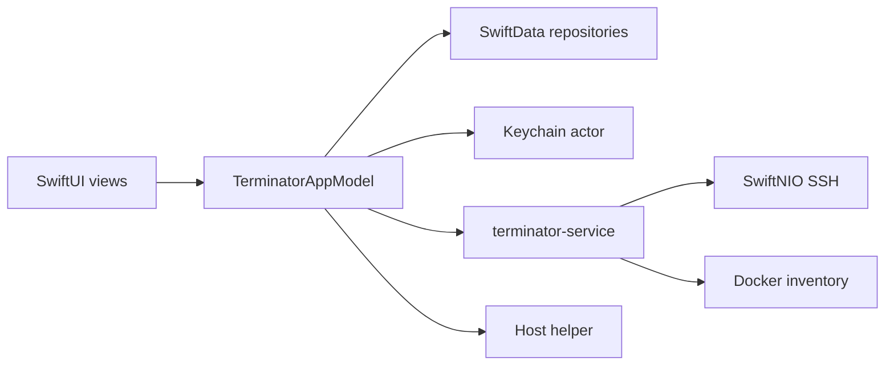

# Terminator

Terminator is a native macOS workspace for SSH hosts, credentials, port forwards, containers, snippets, and session logs.

Ordinary metadata stays in a local SwiftData store with an append-only change history. Private keys, passwords, and helper tokens stay in the Keychain and never enter that history.

## What works

- A macOS 26 SwiftUI app with Direct and Mac App Store schemes built from one codebase.
- A host catalog with search, grouping, sorting, archive, and one inspector per host. OpenSSH and Termius catalogs can be imported through a picker.
- Reusable identities and access keys. A host uses an identity or a manual username with the same model: one password and an ordered set of keys. Keys can be generated as Ed25519, ECDSA, RSA, or Secure Enclave, or imported from OpenSSH and common unencrypted PKCS formats.
- Keychain storage for private material. Metadata changes can be reverted. Replaced secrets stay until an explicit purge.
- SSH through SwiftNIO in the bundled `terminator-service`. The service keeps one pooled connection per host, checks host keys, and attaches an external terminal. A host can run a startup command after login. The detected operating system is stored on the host.
- Saved local, remote, and dynamic port forwards on that pooled connection, with start, stop, and status on the tunnel card.
- A container catalog for Docker on this Mac and on saved hosts. `terminator-service` reads `docker ps` locally and, for a saved host, over SSH.
- Snippets that store a command and run it on a chosen host. The run is recorded in the session log.
- Session logs for connections and snippet runs.
- An optional helper container on a host. It reports host status and reads scheduled tasks. The user crontab is the scheduler Terminator writes. systemd, at, anacron, launchd, and cron.d are detected and shown when present. Host Settings for that host stays in the main window.
- A small MCP server in `terminator-service` for listing hosts, connecting, and reading session output.

## Requirements

- macOS 26 or newer
- Xcode 26 or newer
- Swift 6

The current checkout was verified with Xcode 27 beta and Swift 6.4.

## Build

Open `Terminator.xcodeproj` and select one of the shared schemes:

- **Terminator Direct** — not sandboxed. This is the edition that runs the local connection service and talks to Docker on this Mac.
- **Terminator App Store** — sandboxed with outgoing network access. Local shell support is excluded.

Command-line builds:

```sh
xcodebuild \
  -project Terminator.xcodeproj \
  -scheme "Terminator Direct" \
  -destination "platform=macOS" \
  CODE_SIGNING_ALLOWED=NO \
  build

xcodebuild \
  -project Terminator.xcodeproj \
  -scheme "Terminator App Store" \
  -configuration Debug-AppStore \
  -destination "platform=macOS" \
  CODE_SIGNING_ALLOWED=NO \
  build
```

Run package tests:

```sh
cd Packages/TerminatorKit
swift test
```

The Direct app and its bundled `terminator-service` both access the same macOS Keychain items. Use one stable Apple Development or Developer ID identity for the app and helper during interactive development. Ad-hoc signatures identify each rebuilt executable by a new code hash, so macOS can legitimately ask for Keychain access again after either binary changes.

## Architecture

The macOS app target is a thin composition root. Reusable code lives in a local Swift package that declares macOS 26 and iOS 26 support. The shipping application is the macOS app.



Package products:

- `TerminatorCore` — value types and `Sendable` ports.
- `TerminatorPersistence` — SwiftData records, mapping, repositories, and history.
- `TerminatorSecurity` — Keychain-backed secret storage and key codecs.
- `TerminatorSSH` — the SwiftNIO SSH connection, sessions, tunnels, and Docker poller.
- `TerminatorFeatures` — SwiftUI views and `@Observable` application state.
- `TerminatorConnectionService` — the `terminator-service` process and its MCP server.
- `TerminatorAttach` — the `terminator-attach` helper that binds an external terminal to a session.
- `TerminatorTestSupport` — in-memory ports, fixtures, and mock services.

See [Architecture](Documentation/ARCHITECTURE.md) and [Security](Documentation/SECURITY.md) for the invariants and extension points.

## Security principles

- Secrets never enter SwiftData, history snapshots, UI previews, or application logs.
- Keychain items use `kSecAttrAccessibleWhenUnlockedThisDeviceOnly` and do not sync through iCloud.
- A referenced access-key credential or identity cannot be archived or purged.
- Purging a secret is explicit, confirmed, and irreversible.
- Software private-key export requires system authentication. Secure Enclave private keys are never exportable.
- SSH connections verify host keys. A changed key requires confirmation. Permissive automatic acceptance is not a production mode.
- Remote Docker inventory uses the SSH connection. Plaintext Docker TCP is out of scope.
- The host helper is reached over the SSH tunnel with a pinned certificate. Its token is a Keychain item.

Please do not disclose vulnerabilities in public issues. Until a dedicated security mailbox exists, contact the maintainer privately through the repository owner profile.

## Licensing

Terminator is **source-available**, not OSI Open Source. It is licensed under the [PolyForm Noncommercial License 1.0.0](LICENSE.md).

Personal study, private use, hobby projects, experimentation, modifications, and contributions are welcome under that license. Commercial use requires a separate commercial license from Zewsic.

Commercial licensing: [terminator@zewsic.pro](mailto:terminator@zewsic.pro)
