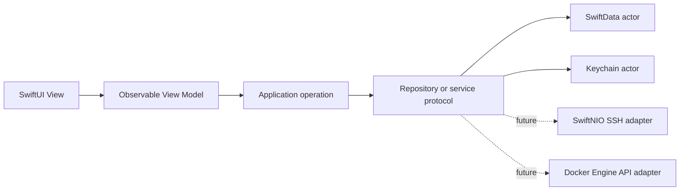

# Terminator

Terminator is a native SwiftUI workspace for SSH sessions, local terminals, port forwarding, Docker infrastructure, credentials, snippets, and file transfers across Apple platforms.

The project exists because infrastructure access should be durable, inspectable, and recoverable. Losing a host catalog or silently replacing credentials is not acceptable. Terminator keeps ordinary metadata versioned and keeps secret material outside that history.

> [!IMPORTANT]
> Terminator is at its first foundation milestone. Host and credential management are functional. SSH, terminal emulation, Docker connectivity, tunnels, snippets, and file transfer are not implemented yet. Container rows in the current UI are explicitly marked demo data.

## What works

- Native macOS 26+ SwiftUI application using `NavigationSplitView` and system navigation styling.
- Create, search, edit, and archive SSH host profiles.
- Create reusable Identities with one embedded password and an ordered set of access keys.
- Configure the same one-password/multiple-keys model directly on a Host in Manual mode.
- Generate Ed25519, ECDSA, RSA, or Secure Enclave access keys as reusable Credentials.
- Omit routine labels: a Host falls back to its hostname and a nested key becomes `Key #N for “Host or Identity”`.
- Import encrypted or unencrypted OpenSSH plus unencrypted PKCS#1, SEC1, and PKCS#8 keys with automatic algorithm detection, normalization, and public-key verification.
- Edit private/public key text and passphrases after system authentication, or load key files through the picker and drag-and-drop.
- Store private material and optional saved passphrases as separate device-only Keychain items.
- Select an Identity or configure a manual username and authentication methods for each Host.
- Keep host and credential metadata in a local SwiftData store.
- Record an append-only change history and revert metadata changes without rewriting history.
- Retain archived and replaced Keychain items until an explicit manual purge.
- Build separate Direct and Mac App Store editions from one codebase.

## Requirements

- macOS 26 or newer
- Xcode 26 or newer
- Swift 6

The current checkout was verified with Xcode 27 beta and Swift 6.4.

## Build

Open `Terminator.xcodeproj` and select one of the shared schemes:

- **Terminator Direct** — not sandboxed; reserves the capability boundary for a future local PTY and user-controlled filesystem access.
- **Terminator App Store** — sandboxed with outgoing network access; local shell support is excluded.

Command-line builds:

```sh
xcodebuild \
  -project Terminator.xcodeproj \
  -scheme "Terminator Direct" \
  -destination "platform=macOS" \
  CODE_SIGNING_ALLOWED=NO \
  build

xcodebuild \
  -project Terminator.xcodeproj \
  -scheme "Terminator App Store" \
  -configuration Debug-AppStore \
  -destination "platform=macOS" \
  CODE_SIGNING_ALLOWED=NO \
  build
```

Run package tests:

```sh
cd Packages/TerminatorKit
swift test
```

## Architecture

The macOS app target is a thin composition root. Reusable code lives in a local Swift package that already declares macOS 26 and iOS 26 support.



Package products:

- `TerminatorCore` — value types and `Sendable` ports.
- `TerminatorPersistence` — SwiftData records, mapping, repositories, and history.
- `TerminatorSecurity` — Keychain-backed secret storage.
- `TerminatorFeatures` — SwiftUI views and `@Observable` application state.
- `TerminatorTestSupport` — in-memory ports, fixtures, and mock services.

See [Architecture](Documentation/ARCHITECTURE.md) and [Security](Documentation/SECURITY.md) for the invariants and extension points.

## Security principles

- Secrets never enter SwiftData, history snapshots, UI previews, or application logs.
- Keychain items use `kSecAttrAccessibleWhenUnlockedThisDeviceOnly` and do not sync through iCloud.
- A referenced access-key Credential or Identity cannot be archived or purged.
- Purging a secret is explicit, confirmed, and irreversible.
- Software private-key export requires system authentication; Secure Enclave private keys are never exportable.
- Future SSH connections must verify host keys; permissive automatic acceptance is not an allowed production mode.
- Future remote Docker access must use SSH or mutually authenticated TLS. Plaintext Docker TCP is out of scope.

Please do not disclose vulnerabilities in public issues. Until a dedicated security mailbox exists, contact the maintainer privately through the repository owner profile.

## Roadmap / TODO

### 1. Foundation

- [x] Modular Swift 6 architecture
- [x] macOS host catalog
- [x] SwiftData metadata storage
- [x] Keychain secret storage
- [x] Append-only history and metadata restore
- [x] Direct and App Store editions
- [ ] Import existing `~/.ssh/config` without copying private key bytes
- [ ] Export an encrypted catalog backup

### 2. SSH

- [ ] SwiftNIO SSH transport
- [ ] Password, key, agent, and keyboard-interactive authentication
- [ ] SSH agent forwarding, disabled by default and enabled explicitly per host
- [ ] Per-host startup command executed only after successful authentication
- [ ] Host chaining / jump hosts, including ordered multi-hop chains and OpenSSH `ProxyJump` import/export
- [ ] Per-host proxy support for direct SSH connections, including SOCKS5 and HTTP CONNECT
- [ ] Per-host environment variables sent when opening a session, with server rejection handled visibly
- [ ] SSH certificates as public attachments to matching access keys, including certified-key, CA fingerprint, principals, and validity checks
- [ ] FIDO2/U2F access keys through a dedicated CTAP2/libfido2 backend with user presence/verification and no stored PIN
- [ ] Strict `known_hosts` management and host-key change warnings
- [ ] Multiple sessions, reconnect, and connection multiplexing

### 3. Terminal and tunnels

- [ ] VT/xterm-compatible renderer
- [ ] Per-host Backspace behavior (`Default`, Control-H, or Delete) without changing the global keyboard mapping
- [ ] Per-host character encoding with UTF-8 as the default and explicit fallback encodings
- [ ] Per-host terminal appearance/profile selection, including a terminal theme override
- [ ] Mosh connections with an explicit SSH bootstrap and clear fallback/error handling when Mosh is unavailable
- [ ] Direct-edition local PTY
- [ ] Local, remote, and dynamic port forwarding
- [ ] Saved tunnel profiles and runtime status

### 4. Docker

- [ ] Local Unix-socket transport
- [ ] Docker Engine API negotiation
- [ ] Remote Docker over the existing SSH transport
- [ ] Containers, Compose projects, services, events, logs, lifecycle actions, and exec
- [ ] Aggregated health monitoring across endpoints

### 5. Files and automation

- [ ] SFTP browser and resumable transfers
- [ ] Local-to-server and server-to-server transfers with checksums
- [ ] Parameterized command snippets
- [ ] Auditable batch actions

### 6. Sharing and collaboration

- [ ] Share a host without sharing secrets by default; credentials require a separate explicit, encrypted grant
- [ ] Define permissions, revocation, audit history, and conflict handling before enabling shared-host editing

### 7. Sync and recovery

- [ ] Client-side encrypted CloudKit or file-based sync
- [ ] Deterministic conflict resolution
- [ ] Backup verification and disaster-recovery flow

### 8. Other platforms

- [ ] iOS and iPadOS companion targets using the shared package
- [ ] Evaluate watchOS monitoring and safe, limited actions
- [ ] Add other Apple platforms only where the interaction model is useful

## Licensing

Terminator is **source-available**, not OSI Open Source. It is licensed under the [PolyForm Noncommercial License 1.0.0](LICENSE.md).

Personal study, private use, hobby projects, experimentation, modifications, and contributions are welcome under that license. Commercial use requires a separate commercial license from Zewsic.

Commercial licensing: [terminator@zewsic.pro](mailto:terminator@zewsic.pro)
